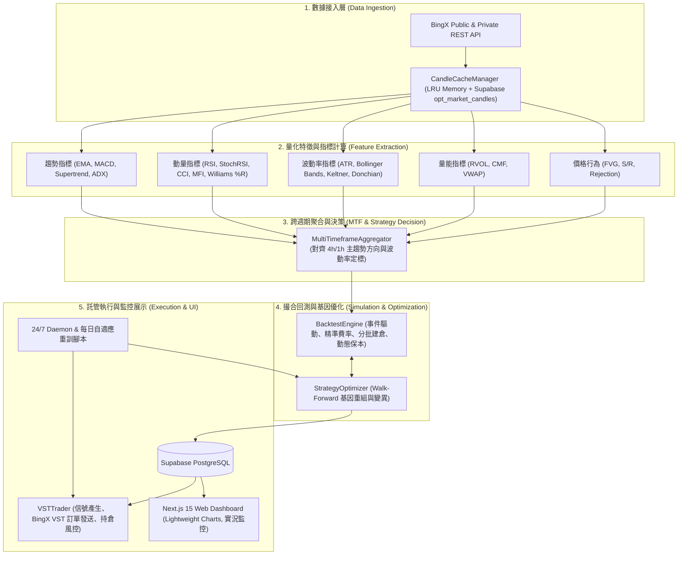

# 📐 系統架構與數學量化模型深度剖析 (System Architecture & Quantitative Engine)

本文檔詳細解析 **Crypto Strategy Optimizer & BingX VST Automated Trading System** 的底層架構、數學模型、指標計算邏輯、走步式前向優化演算法、倉位管理體系以及 Supabase 資料庫綱要。

---

## 📑 目錄 (Table of Contents)

- [1. 總體分層架構 (System Architecture Overview)](#1-總體分層架構-system-architecture-overview)
- [2. 行情數據與快取機制 (Market Data & Caching)](#2-行情數據與快取機制-market-data--caching)
- [3. 多維技術指標數學實作 (Technical Indicators Engine)](#3-多維技術指標數學實作-technical-indicators-engine)
- [4. 跨週期共振架構 (Multi-Timeframe / MTF Alignment)](#4-跨週期共振架構-multi-timeframe--mtf-alignment)
- [5. 事件驅動回測撮合器 (Event-Driven Backtest Engine)](#5-事件驅動回測撮合器-event-driven-backtest-engine)
  - [手續費與滑點模型](#手續費與滑點模型)
  - [15/30/40/15 分批進場架構 (Tranche Scale-in)](#15304015-分批進場架構-tranche-scale-in)
  - [多階階梯止盈與保本推進 (TP / Trailing SL / Break-Even)](#多階階梯止盈與保本推進-tp--trailing-sl--break-even)
  - [日內單日最大虧損熔斷 (Daily Loss Circuit Breaker)](#日內單日最大虧損熔斷-daily-loss-circuit-breaker)
- [6. 走步式前向基因演算法 (Walk-Forward Genetic Optimizer)](#6-走步式前向基因演算法-walk-forward-genetic-optimizer)
  - [適應度函數 (Fitness Function)](#適應度函數-fitness-function)
  - [過度擬合防護 (Robustness Ratio)](#過度擬合防護-robustness-ratio)
- [7. 實盤與模擬盤執行器 (VST Execution Engine)](#7-實盤與模擬盤執行器-vst-execution-engine)
- [8. Supabase 資料庫完整綱要 (Database Schema)](#8-supabase-資料庫完整綱要-database-schema)

---

## 1. 總體分層架構 (System Architecture Overview)

本系統採用模組化與單向數據流設計，主要由五大子系統組成：



---

## 2. 行情數據與快取機制 (Market Data & Caching)

實作檔案：`src/lib/bingx/client.ts`, `src/lib/bingx/cache.ts`

- **多級快取 (Multi-Tier Caching)**：
  1. **記憶體快取 (In-Memory)**：近期熱門 K 線於記憶體保留一定條數，秒級重複請求直接零延遲回傳。
  2. **永久持久化 (Supabase 快取)**：寫入 `opt_market_candles` 資料表，避免頻繁發送 API 撞破交易所 Rate Limit。
  3. **遠端備援 (Fallback)**：當快取不足或為最新未閉合蠟燭時，直連 BingX 官方 REST 端點獲取最新行情。
- **標準 K 線結構 (`Candle`)**：
  ```typescript
  export interface Candle {
    time: number;   // Unix timestamp (毫秒)
    open: number;   // 開盤價
    high: number;   // 最高價
    low: number;    // 最低價
    close: number;  // 收盤價
    volume: number; // 成交量
  }
  ```

---

## 3. 多維技術指標數學實作 (Technical Indicators Engine)

實作目錄：`src/lib/engine/indicators/`  
所有演算法均使用純 TypeScript 高速實作，無額外重量級依賴。

### A. 趨勢類指標 (`trend.ts`)
- **指數移動平均線 (Exponential Moving Average - EMA)**：
  $$\alpha = \frac{2}{N + 1}$$
  $$EMA_t = \alpha \cdot Price_t + (1 - \alpha) \cdot EMA_{t-1}$$
- **Supertrend 指標**：
  $$\text{Basic Upper} = \frac{High + Low}{2} + (\text{Multiplier} \times ATR)$$
  $$\text{Basic Lower} = \frac{High + Low}{2} - (\text{Multiplier} \times ATR)$$
  支援自適應動態波段軌道反轉偵測。
- **MACD (Moving Average Convergence Divergence)**：
  $$DIF = EMA_{12} - EMA_{26}$$
  $$DEA = EMA_9(DIF)$$
  $$MACD\_Hist = (DIF - DEA) \times 2$$
- **ADX (Average Directional Index)**：
  衡量趨勢強弱，過濾無趨勢之震盪行情。

### B. 動量類指標 (`momentum.ts`)
- **相對強弱指標 (RSI)**：
  $$RS = \frac{\text{Average Gain}}{\text{Average Loss}}$$
  $$RSI = 100 - \left(\frac{100}{1 + RS}\right)$$
- **隨機指標 RSI (Stochastic RSI)**：
  $$\text{StochRSI} = \frac{RSI - \min(RSI, n)}{\max(RSI, n) - \min(RSI, n)}$$
  輔以 %K 與 %D 之平滑雙線交叉信號。
- **其他動量**：Williams %R、商品路徑指標 (CCI)、資金流量指標 (MFI)。

### C. 波動率指標 (`volatility.ts`)
- **真實波動區間 (Average True Range - ATR)**：
  $$TR = \max(High - Low, |High - Close_{prev}|, |Low - Close_{prev}|)$$
  $$ATR = \text{WilderSmoothing}(TR, N)$$
  作為動態止損點數 (`slAtrMultiplier * ATR`) 與加減倉間距之物理基準。
- **布林通道 (Bollinger Bands)** 與 **肯特納通道 (Keltner Channels)**。

### D. 量能類指標 (`volume.ts`)
- **相對成交量 (Relative Volume - RVOL)**：
  $$RVOL = \frac{\text{當前棒成交量}}{SMA(\text{成交量}, N)}$$
  若 $RVOL > 1.15$ 代表有主力爆量異動，確認進場動能。
- **成交量加權平均價 (VWAP)** 與 **蔡金資金流 (CMF)**。

### E. 價格行為結構 (`price_action.ts`)
- **公允價值缺口 (Fair Value Gap - FVG)**：偵測三根連續 K 線之不平衡失衡區。
- **長針拒絕形態 (Rejection Pinbar)** 與 **支撐阻力關鍵位判定**。

---

## 4. 跨週期共振架構 (Multi-Timeframe / MTF Alignment)

實作檔案：`src/lib/engine/mtf.ts`

當前週期（例如 5m 或 15m）容易受到高頻雜訊干擾，系統實施多層級跨週期共振濾網：
1. **主趨勢濾網 (HTF Trend Filter)**：
   - 若操作 `5m` 週期，強制參考 `15m` 或 `1h` 趨勢。
   - 若操作 `15m` 週期，強制參考 `1h` 趨勢。
   - 若操作 `1h` 週期，強制參考 `4h` 趨勢。
   - 僅當高週期 Supertrend 與 EMA200 呈現多頭架構時，才允許低週期觸發多頭進場。
2. **波動率定標 (Volatility Regime Scaling)**：
   - 參考高階週期的 ATR 波動比率，在市場劇烈波動（High Volatility Regime）時，自適應拉大止損距離或下修保證金曝險。
3. **關鍵位規避 (Key Level Avoidance)**：
   - 若前方極近距離存在高週期密集阻力位，暫緩市價追高，等待實體突破。

---

## 5. 事件驅動回測撮合器 (Event-Driven Backtest Engine)

實作檔案：`src/lib/engine/backtester.ts`

### 手續費與滑點模型
- **Maker 費率**：預設 $0.02\%$ (`0.0002`)
- **Taker 費率**：預設 $0.05\%$ (`0.0005`)
- **滑點 (Slippage)**：預設 $3\text{ bps}$ ($0.0003$)
- **淨損益計算**：嚴格於每筆部分平倉與全平倉中扣減手續費與滑點損耗，貼近真盤環境。

### 15/30/40/15 分批進場架構 (Tranche Scale-in)
為了降低單點重倉猜頂底的風險，本系統內建四階分批建倉比例：

| Tranche | 比例 | 名稱 | 觸發條件說明 |
| :---: | :---: | :---: | :--- |
| **T1** | **15%** | **試單 (Scout)** | 核心信號（如 RSI 超賣 + EMA 拐頭）成立時立即以小倉位試水溫 |
| **T2** | **30%** | **回踩加倉 (Scale-in)** | 趨勢初顯且價格小幅回踩關鍵均線或布林中軌，以更優價格吸籌 |
| **T3** | **40%** | **結構確認主倉 (Confirmed)** | 突破關鍵高點或形成多頭吞噬，主力結構確認，注入核心部位 |
| **T4** | **15%** | **尾倉順勢 (Runner)** | 順強勢突破，推動最後 15% 參與後續趨勢單邊主升段 |

### 多階階梯止盈與保本推進 (TP / Trailing SL / Break-Even)
- **TP1 (1.5R 盈虧比)**：
  - 平倉總倉位之 $35\%$。
  - **自動推保本 (Move SL to Break-Even)**：立即將剩餘倉位之止損價移動至開倉均價加計手續費緩衝區，確保該筆交易立於不敗之地。
- **TP2 (3.0R 盈虧比)**：
  - 平倉總倉位之 $35\%$。
  - **啟動移動止損 (Activate Trailing SL)**：以 $2.0 \times ATR$ 距離沿最高價/最低價動態上移/下移防守線。
- **TP3 (6.0R 盈虧比)**：
  - 出清剩餘 $30\%$ 倉位，或持續由 Trailing SL 獲利出場。

### 日內單日最大虧損熔斷 (Daily Loss Circuit Breaker)
- 設定 `maxDailyLossUsdt`（預設 80 USDT）。
- 回測與實盤交易中，若當日累計虧損達到該閾值，系統自動觸發熔斷開關，暫停當日剩餘所有開倉行為，隔日 00:00 自動解鎖重置。

---

## 6. 走步式前向基因演算法 (Walk-Forward Genetic Optimizer)

實作檔案：`src/lib/engine/optimizer.ts`

### 適應度函數 (Fitness Function)

$$Fitness = \Big( 0.35 \cdot Sharpe + 0.25 \cdot Sortino + 0.20 \cdot \min(PF, 5) + 0.20 \cdot WinRate \Big) \times Scale_{Trades} - Penalty_{MaxDD}$$

其中：
- $Sharpe$：年化夏普比率。
- $Sortino$：索提諾比率（僅懲罰下行波動）。
- $PF$：獲利因子 (Profit Factor = 總獲利 / 總虧損)。
- $Scale_{Trades} = \min(1.0, \frac{Trades}{20})$：交易次數低於 20 次時進行樣本不足懲罰；低於 5 次直接給予 -100 分。
- $Penalty_{MaxDD} = \frac{MaxDrawdown\%}{100} \times 0.5$：嚴格壓制最大回撤。

### 過度擬合防護 (Robustness Ratio)
1. **樣本分割**：
   - 70% 樣本內 (In-Sample)：用於基因演算法的個體交叉、變異與適應度演化。
   - 30% 樣本外 (Out-of-Sample)：用全新從未訓練過的盲測數據進行檢驗。
2. **審核標準 (Approval Criteria)**：
   - 樣本外 Sharpe $\ge 0.3$
   - 樣本外最大回撤 MaxDD $\le 35\%$
   - 樣本外交易次數 $\ge 3$
   - 計算穩健比率：
     $$RobustnessRatio = \frac{Sharpe_{OOS}}{Sharpe_{IS}}$$
   - 僅當符合標準時，策略狀態才會標記為 `OPTIMIZED` 並正式發布上線；否則維持 `MAINTAINED`。

---

## 7. 實盤與模擬盤執行器 (VST Execution Engine)

實作檔案：`src/lib/execution/vstTrader.ts`, `src/lib/bingx/vstClient.ts`

- **BingX VST 介面特色**：
  - 支援全幣種模擬保證金合約交易（USDT-M Perpetual Swap）。
  - 使用 HMAC-SHA256 進行 API 請求簽名。
  - 具備即時槓桿設定 (`setLeverage`)、保證金模式切換、市價委託與觸發止盈止損單。
- **守護輪詢 (Polling & Reaction)**：
  - 由 `auto_trader_daemon.ts` 驅動，預設每 30 秒執行全週期全幣種狀態掃描。
  - 偵測到現有持倉達到 TP1/TP2 條件時，依序分批減倉並修改掛單止損點。

---

## 8. Supabase 資料庫完整綱要 (Database Schema)

系統底層依托 9 張專業 PostgreSQL 資料表：

| 資料表名稱 (Table Name) | 主要功能說明 | 關鍵欄位 (Key Columns) |
| :--- | :--- | :--- |
| **`opt_strategies`** | 策略模型參數儲存與版本控制 | `id`, `name`, `symbol`, `timeframe`, `indicators_config`, `risk_config`, `tranches`, `take_profits`, `is_active` |
| **`opt_backtest_runs`** | 回測與優化記錄報告 | `id`, `strategy_id`, `net_profit_pct`, `win_rate`, `sharpe_ratio`, `max_drawdown_pct`, `total_trades`, `total_fees_paid` |
| **`opt_backtest_trades`** | 單筆交易明細紀錄 | `id`, `run_id`, `symbol`, `direction`, `entry_time`, `exit_time`, `entry_price`, `exit_price`, `pnl`, `net_pnl`, `exit_reason` |
| **`opt_daily_reports`** | 每日自動化審計日記 | `id`, `report_date`, `symbol`, `timeframe`, `status`, `volatility_regime`, `improvement_metrics`, `report_markdown` |
| **`opt_market_candles`** | 歷史 K 線數據快取庫 | `id`, `symbol`, `timeframe`, `candle_time`, `open`, `high`, `low`, `close`, `volume` |
| **`opt_live_positions`** | 實盤/VST 當前活動持倉追蹤 | `id`, `symbol`, `timeframe`, `direction`, `entry_price`, `total_qty`, `remaining_qty`, `current_sl`, `is_be_triggered`, `status` |
| **`opt_live_orders`** | 實盤/VST 訂單成交日誌 | `id`, `position_id`, `symbol`, `order_type`, `direction`, `price`, `qty`, `status`, `exchange_order_id` |
| **`opt_cron_configs`** | 定時任務配置與開關 | `id`, `job_name`, `cron_expression`, `is_enabled`, `last_run_at`, `next_run_at` |
| **`opt_cron_logs`** | 定時任務執行歷史與錯誤排查 | `id`, `job_name`, `status`, `duration_ms`, `message`, `created_at` |
