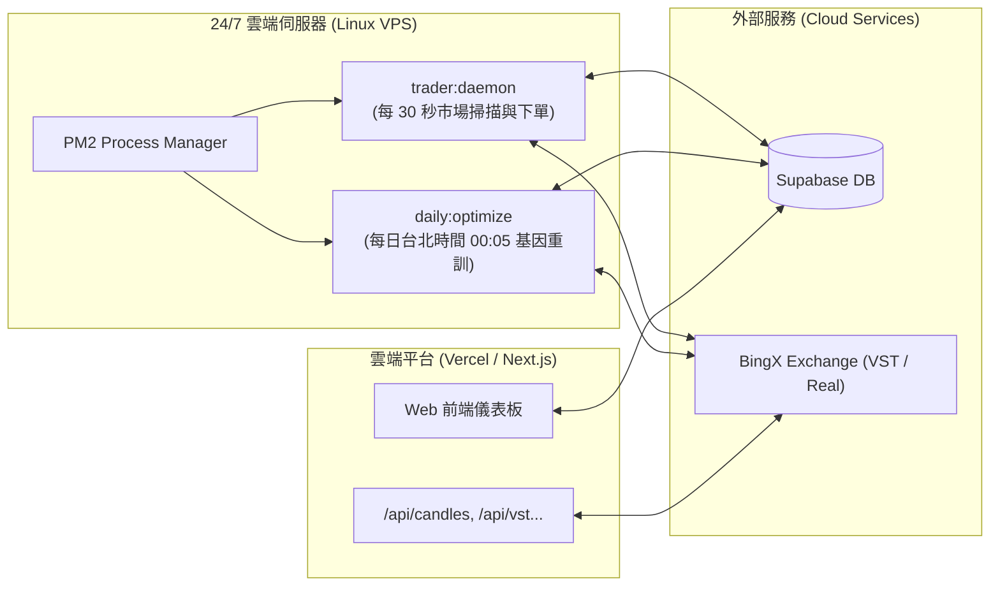

# 🚢 生產環境部署與 24/7 維運指南 (Production Deployment & Operations Guide)

本指南說明如何將 **Crypto Strategy Optimizer** 部署至生產環境，包含 **Next.js 15 Web 儀表板**、**24/7 背景交易守護進程 (Auto-Trader Daemon)**、以及 **每日定時基因優化排程 (Daily Optimizer)**。

---

## 📑 目錄 (Table of Contents)

- [部署架構概述 (Deployment Architecture)](#部署架構概述-deployment-architecture)
- [1. 環境變數清單 (Environment Variables)](#1-環境變數清單-environment-variables)
- [2. 網頁服務端部署 (Web Dashboard Deployment)](#2-網頁服務端部署-web-dashboard-deployment)
  - [方案 A：部署至 Vercel (推薦)](#方案-a部署至-vercel-推薦)
  - [方案 B：自行託管 (Node.js / Docker)](#方案-b自行託管-nodejs--docker)
- [3. 24/7 背景交易 Daemon 部署 (Auto-Trader Daemon)](#3-247-背景交易-daemon-部署-auto-trader-daemon)
  - [使用 PM2 進程守護器 (推薦)](#使用-pm2-進程守護器-推薦)
  - [使用 Linux Systemd 服務](#使用-linux-systemd-服務)
- [4. 每日基因優化定時任務 (Daily Optimizer Schedule)](#4-每日基因優化定時任務-daily-optimizer-schedule)
  - [Linux Crontab 設定](#linux-crontab-設定)
  - [GitHub Actions 自動化排程](#github-actions-自動化排程)
- [5. API 金鑰安全與風控規範 (Security & Risk Controls)](#5-api-金鑰安全與風控規範-security--risk-controls)
- [6. 維運監控與緊急手動熔斷 (Monitoring & Emergency Operations)](#6-維運監控與緊急手動熔斷-monitoring--emergency-operations)

---

## 部署架構概述 (Deployment Architecture)

量化交易系統包含兩大運行模式：
1. **Web 與 API 服務**：提供使用者互動面板、回測視覺化與 Webhook 端點（適合部署於 Vercel 或 Linux VPS）。
2. **常駐守護進程 (Long-running Daemon)**：維持 24/7 秒級或分級無中斷輪詢，嚴密監控 BingX 實盤與持倉狀態（適合部署於具備長效網路與固定 IP 的 Linux 雲端伺服器，如 AWS EC2, GCP Compute Engine, 或 DigitalOcean Droplet）。



---

## 1. 環境變數清單 (Environment Variables)

請確保生產環境注入以下環境變數：

| 變數名稱 | 必要性 | 範例 / 格式 | 說明 |
| :--- | :---: | :--- | :--- |
| `NEXT_PUBLIC_SUPABASE_URL` | **必須** | `https://xxxx.supabase.co` | Supabase 專案端點 URL |
| `NEXT_PUBLIC_SUPABASE_ANON_KEY` | **必須** | `eyJhbGciOi...` | Supabase 公開匿名客戶端金鑰 |
| `BINGX_BASE_URL` | **必須** | `https://open-api.bingx.com` | BingX 官方開放 API 域名 |
| `BINGX_API_KEY` | **必須** | `32 位元英數字串` | 具備 VST / 合約交易權限之 API Key |
| `BINGX_API_SECRET` | **必須** | `32 位元英數字串` | 密鑰簽名金鑰 (HMAC-SHA256) |
| `PORT` | 選用 | `3002` | Next.js 網頁伺服器監聽端口 (預設 3002) |

---

## 2. 網頁服務端部署 (Web Dashboard Deployment)

### 方案 A：部署至 Vercel (推薦)
1. 將程式碼推送至 GitHub 私有儲存庫。
2. 登入 [Vercel 控制台](https://vercel.com/)，選擇 **Import Project**。
3. Framework Preset 選擇 **Next.js**。
4. 於 **Environment Variables** 填入上述環境變數。
5. 點擊 **Deploy** 完成部署。

### 方案 B：自行託管 (Node.js / Docker)

在 Linux 伺服器建置並啟動服務：

```bash
# 1. 建置生產包
npm run build

# 2. 啟動生產伺服器 (背景常駐)
npm run start
```

若使用 Docker，可參考標準 Next.js Standalone Dockerfile 進行容器化打包。

---

## 3. 24/7 背景交易 Daemon 部署 (Auto-Trader Daemon)

自動交易守護進程 (`scripts/auto_trader_daemon.ts`) 需要永久在背景運行，並在意外發生時自動重啟。

### 使用 PM2 進程守護器 (推薦)

1. 全域安裝 PM2：
   ```bash
   npm install -g pm2
   ```

2. 在專案根目錄建立 `ecosystem.config.cjs`：
   ```javascript
   module.exports = {
     apps: [
       {
         name: "trade-vst-daemon",
         script: "node",
         args: "--use-system-ca ./node_modules/tsx/dist/cli.mjs scripts/auto_trader_daemon.ts",
         env: {
           NODE_ENV: "production",
         },
         restart_delay: 5000,
         max_restarts: 50,
         autorestart: true,
         watch: false,
         log_date_format: "YYYY-MM-DD HH:mm:ss Z",
         error_file: "./logs/daemon-error.log",
         out_file: "./logs/daemon-out.log",
       },
     ],
   };
   ```

3. 啟動並設定開機自啟動：
   ```bash
   # 建立日誌資料夾
   mkdir -p logs

   # 啟動守護進程
   pm2 start ecosystem.config.cjs

   # 保存狀態並設定伺服器開機自啟
   pm2 save
   pm2 startup
   ```

4. 常用維護命令：
   ```bash
   pm2 status                 # 查看運行狀態
   pm2 logs trade-vst-daemon  # 檢視實時交易日誌
   pm2 restart trade-vst-daemon # 重新啟動守護進程
   pm2 stop trade-vst-daemon  # 暫停守護進程
   ```

---

### 使用 Linux Systemd 服務

在 `/etc/systemd/system/trade-daemon.service` 建立服務設定：

```ini
[Unit]
Description=Antigravity Crypto VST Auto Trader Daemon
After=network.target

[Service]
Type=simple
User=ubuntu
WorkingDirectory=/home/ubuntu/trade_system
ExecStart=/usr/bin/npm run trader:daemon
Restart=always
RestartSec=10
EnvironmentFile=/home/ubuntu/trade_system/.env.local

[Install]
WantedBy=multi-user.target
```

啟用與啟動：
```bash
sudo systemctl daemon-reload
sudo systemctl enable trade-daemon
sudo systemctl start trade-daemon
sudo journalctl -u trade-daemon -f
```

---

## 4. 每日基因優化定時任務 (Daily Optimizer Schedule)

### Linux Crontab 設定

每日台北時間午夜 00:05 (UTC 16:05) 自動擷取全新歷史 K 棒，進行 Walk-Forward 樣本外驗證優化並更新至 Supabase：

```bash
crontab -e
```

加入以下設定行：
```cron
# 每日 00:05 (Asia/Taipei) 執行基因優化
5 0 * * * cd /home/ubuntu/trade_system && /usr/bin/npm run optimize >> /home/ubuntu/trade_system/logs/daily_optimize.log 2>&1
```

---

### GitHub Actions 自動化排程

若不希望在本地 VPS 設定 crontab，亦可在儲存庫中加入 `.github/workflows/daily_optimize.yml`：

```yaml
name: Daily Strategy Optimizer

on:
  schedule:
    # 每天 UTC 16:05 相當於台北時間 00:05
    - cron: '5 16 * * *'
  workflow_dispatch:

jobs:
  optimize:
    runs-on: ubuntu-latest
    steps:
      - uses: actions/checkout@v4
      - uses: actions/setup-node@v4
        with:
          node-version: 22
          cache: 'npm'
      - run: npm ci
      - run: npm run optimize
        env:
          NEXT_PUBLIC_SUPABASE_URL: ${{ secrets.SUPABASE_URL }}
          NEXT_PUBLIC_SUPABASE_ANON_KEY: ${{ secrets.SUPABASE_ANON_KEY }}
          BINGX_BASE_URL: https://open-api.bingx.com
          BINGX_API_KEY: ${{ secrets.BINGX_API_KEY }}
          BINGX_API_SECRET: ${{ secrets.BINGX_API_SECRET }}
```

---

## 5. API 金鑰安全與風控規範 (Security & Risk Controls)

> [!IMPORTANT]
> 1. **最小權限原則**：建立 BingX API Key 時，僅開啟「合約交易 (Futures/Swap)」與「讀取權限」，**絕對不要勾選「提現 (Withdrawal)」** 權限！
> 2. **IP 白名單綁定**：強烈建議在 BingX 後台將 API Key 綁定至 VPS 的固定靜態外網 IP，避免金鑰洩漏造成資產風險。
> 3. **模擬盤隔離**：開發與測試階段一律使用 BingX VST 虛擬實盤交易，嚴防誤觸真金帳戶。

---

## 6. 維運監控與緊急手動熔斷 (Monitoring & Emergency Operations)

### 單日虧損熔斷機制 (Circuit Breaker)
- 當日若連續遇到極端反向行情，累計虧損達到 `maxDailyLossUsdt`（預設 80 USDT）時，系統將自動鎖定，拒絕一切新開倉請求，並在日誌輸出警報。

### 一鍵緊急全平倉 (Emergency Stop)
若市場發生不可預期黑天鵝事件，可採取以下處置：
1. **停止守護進程**：
   ```bash
   pm2 stop trade-vst-daemon
   ```
2. **前台儀表板平倉**：
   造訪 `/vst` 頁面，於「即時持倉」列表中點擊各倉位的「緊急市價平倉」按鈕。
3. **BingX App / Web 端**：
   直接開啟 BingX 官方 App 的 VST 模擬盤合約持倉界面，進行一鍵市價全平。
