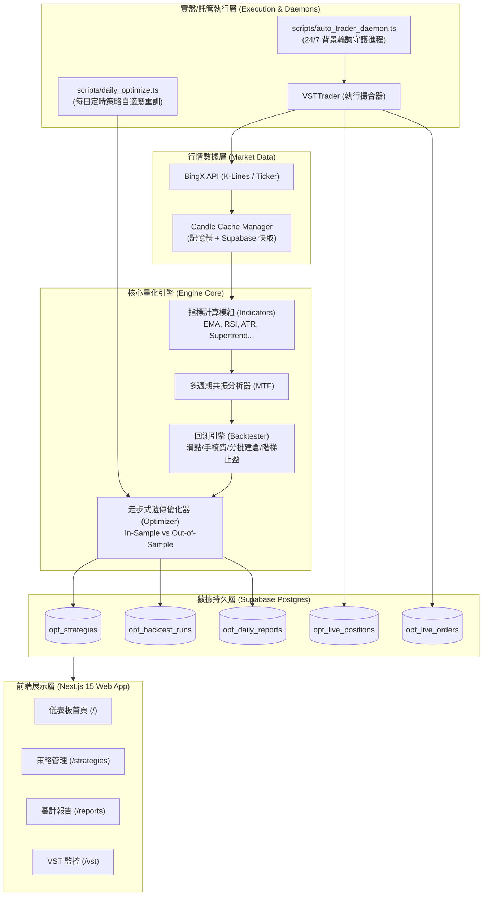

# 🚀 Crypto Strategy Optimizer & BingX VST Automated Trading System

> **全自動化加密貨幣量化交易策略優化平台與 BingX VST 24/7 模擬實盤託管系統**  
> 基於 **Next.js 15 (App Router)**、**TypeScript**、**Tailwind CSS**、**Lightweight Charts** 與 **Supabase** 構建。

---

## 📑 目錄 (Table of Contents)

- [系統核心特性 (Key Features)](#-系統核心特性-key-features)
- [系統架構概覽 (System Architecture)](#-系統架構概覽-system-architecture)
- [支援標的與週期 (Supported Symbols & Timeframes)](#-支援標的與週期-supported-symbols--timeframes)
- [技術堆疊 (Tech Stack)](#-技術堆疊-tech-stack)
- [快速開始 (Quick Start)](#-快速開始-quick-start)
  - [環境需求 (Prerequisites)](#環境需求-prerequisites)
  - [安裝依賴 (Installation)](#安裝依賴-installation)
  - [環境變數配置 (Environment Variables)](#環境變數配置-environment-variables)
  - [啟動開發伺服器 (Development Server)](#啟動開發伺服器-development-server)
- [指令與腳本參考 (NPM Scripts & CLI)](#-指令與腳本參考-npm-scripts--cli)
  - [每日走步式基因優化 (Daily Optimizer)](#1-每日走步式基因優化-daily-optimizer)
  - [24/7 BingX VST 自動託管 Daemon](#2-247-bingx-vst-自動託管-daemon)
  - [單元與整合測試 (Tests)](#3-單元與整合測試-tests)
- [目錄結構 (Project Structure)](#-目錄結構-project-structure)
- [相關文檔導覽 (Documentation Index)](#-相關文檔導覽-documentation-index)
- [風險免責聲明 (Risk Disclaimer)](#-風險免責聲明-risk-disclaimer)

---

## 🌟 系統核心特性 (Key Features)

1. **多指標數學量化引擎 (Multi-Indicator Quantitative Engine)**
   - 包含 **Trend**（EMA 多重均線、MACD、Supertrend、ADX）、**Momentum**（RSI、Stochastic RSI、Williams %R、CCI、MFI）、**Volatility**（ATR、Bollinger Bands、Keltner Channels、Donchian）、**Volume**（RVOL 相對成交量、CMF 資金流向、VWAP）及 **Price Action**（FVG 缺口、支撐阻力、Pinbar 拒絕形態）。

2. **跨週期共振驗證 (Multi-Timeframe / MTF Resonance)**
   - 次週期（如 5m、15m、1h）進場前，自動檢驗高階主週期（如 4h、1h）趨勢濾網，避免逆大勢開倉。

3. **走步式前向基因演算法 (Walk-Forward Genetic Optimization)**
   - 採用 **70% 樣本內 (In-Sample) 訓練** + **30% 樣本外 (Out-of-Sample) 驗證**，並計算 Robustness Ratio（樣本外 Sharpe / 樣本內 Sharpe），嚴格防範過度擬合 (Overfitting)。

4. **15 / 30 / 40 / 15 動態分批建倉模型 (Tranche Scale-in Execution)**
   - **Tranche 1 (15%)**: 試單 (Scout - 信號觸發即時進場)。
   - **Tranche 2 (30%)**: 更優價加倉 (Scale-in - 沿趨勢回踩加碼)。
   - **Tranche 3 (40%)**: 結構確認主倉 (Confirmed - 形態突破確認)。
   - **Tranche 4 (15%)**: 尾倉順勢 (Runner - 強勢突破擴大戰果)。

5. **多階階梯止盈與保本風控 (Multi-target Take-Profit & Dynamic Trailing Stop-Loss)**
   - 預設三段階梯分批止盈（例如 1.5R 止盈 35% 並自動推保本 BE、3.0R 止盈 35% 並啟用移動止損、6.0R 跑完尾倉）。
   - 內置單日累計最大虧損熔斷機制 (`maxDailyLossUsdt` 預設 80 USDT)。

6. **BingX VST 虛擬實盤交易串接 (Virtual Simulated Trading Execution)**
   - 透過 BingX Official VST 介面進行真市場行情下的無風險實時委託、保證金與槓桿管理、限價/市價進出場及倉位追蹤。

7. **全功能現代化響應式監控面板 (Responsive Full-Stack Web Dashboard)**
   - Next.js 15 App Router + Tailwind CSS + TradingView Lightweight Charts。
   - 包含資產權益走勢曲線、績效指標卡、多週期矩陣、實時 K 線圖標記進出場點、策略版本管理、每日回測審計日誌與 VST 實盤監控。

---

## 🏛️ 系統架構概覽 (System Architecture)



---

## 🪙 支援標的與週期 (Supported Symbols & Timeframes)

### 支援幣種
系統在 `src/lib/engine/types.ts` 定義了 9 組主流與強勢合約交易對：
- `BTC-USDT`
- `ETH-USDT`
- `SOL-USDT`
- `BNB-USDT`
- `XRP-USDT`
- `ADA-USDT`
- `LINK-USDT`
- `XLM-USDT`
- `HYPE-USDT`

### 支援時間週期
- `5m` (極短線 / 高頻套利)
- `15m` (日內短波段)
- `1h` (標準波段交易)
- `4h` (中長線趨勢波段 / 主趨勢參考)

---

## 🛠️ 技術堆疊 (Tech Stack)

| 領域 | 技術 / 套件 | 說明 |
| :--- | :--- | :--- |
| **框架 (Framework)** | [Next.js 15.1+](https://nextjs.org/) (App Router) | 全端 React 服務端渲染與 API Routes |
| **前端函式庫** | [React 19](https://react.dev/) | 現代組件化 UI 架構 |
| **圖表呈現** | [Lightweight Charts](https://tradingview.github.io/lightweight-charts/) | TradingView 高效能互動式 K 線與權益走勢圖 |
| **樣式設計** | [Tailwind CSS 3.4](https://tailwindcss.com/) + Lucide React | 暗黑系專業交易界面與圖標庫 |
| **資料庫 (Database)** | [Supabase](https://supabase.com/) (PostgreSQL) | 儲存策略模型、回測結果、K線快取、持倉與訂單 |
| **交易交易所** | [BingX API (VST)](https://bingx.com/) | 實時行情獲取與 VST 模擬盤合約下單 |
| **執行環境 (CLI)** | [tsx](https://github.com/privatenumber/tsx) + Node.js 22 | 高速 TypeScript 腳本與 Daemon 執行環境 |

---

## ⚡ 快速開始 (Quick Start)

### 環境需求 (Prerequisites)
- **Node.js** >= 20.0.0 (建議 22.x LTS)
- **npm** >= 10.x 或 **pnpm** / **yarn**
- **Supabase 專案** (URL 與 Anon Key)
- **BingX API Key / Secret** (可支援實盤或 VST 模擬合約)

### 安裝依賴 (Installation)

```bash
git clone <repository-url> trade_system
cd trade_system
npm install
```

### 環境變數配置 (Environment Variables)

複製 `.env.example` 或在根目錄建立 `.env.local`：

```bash
# Supabase 資料庫連線配置
NEXT_PUBLIC_SUPABASE_URL=https://your-supabase-project.supabase.co
NEXT_PUBLIC_SUPABASE_ANON_KEY=your-anon-key

# BingX API 配置
BINGX_BASE_URL=https://open-api.bingx.com
BINGX_API_KEY=your-bingx-api-key
BINGX_API_SECRET=your-bingx-api-secret
```

### 啟動開發伺服器 (Development Server)

```bash
npm run dev
```

伺服器預設於端口 **`http://localhost:3002`** 啟動。  
開啟瀏覽器進入首頁即可查看 TradingView 圖表、策略矩陣與回測系統。

---

## 💻 指令與腳本參考 (NPM Scripts & CLI)

在 `package.json` 中配置了齊全的開發、建置、測試與自動化交易命令：

| 命令 | 說明 |
| :--- | :--- |
| `npm run dev` | 啟動 Next.js 開發環境 (監聽端口 3002) |
| `npm run build` | 建置 Next.js 正式生產環境包 |
| `npm run start` | 啟動生產伺服器 (端口 3002) |
| `npm run optimize` | 執行所有/指定幣種與週期的每日前向基因優化訓練 |
| `npm run trader:daemon` | 啟動 24/7 背景輪詢守護進程，自動掃描並執行 VST 訂單 |
| `npm run test:indicators` | 測試技術指標 (EMA, RSI, ATR, Supertrend, VWAP 等) 數值準確度 |
| `npm run test:backtest` | 測試回測撮合引擎、手續費扣除、滑點損耗與止盈止損 |
| `npm run test:bingx` | 測試 BingX API K 線擷取與簽名連線能力 |

---

### 1. 每日走步式基因優化 (Daily Optimizer)

可定期對支援的幣種與週期進行自適應重訓，產生最佳參數並儲存於 Supabase：

```bash
# 預設對所有幣種與週期 (4h, 1h, 15m, 5m) 進行全面訓練
npm run optimize

# 指定特定幣種
npx tsx scripts/daily_optimize.ts --symbols=BTC-USDT,SOL-USDT

# 指定特定週期
npx tsx scripts/daily_optimize.ts --symbols=ETH-USDT --timeframes=1h,15m
```

### 2. 24/7 BingX VST 自動託管 Daemon

自動化守護進程會以 30 秒為間隔持續對全市場進行掃描：
- 檢查高階趨勢濾網共振
- 判定開倉信號並發送 VST 訂單
- 追蹤持倉動態，更新階梯止盈、觸發移動止損或單日熔斷

```bash
npm run trader:daemon
```

---

### 3. 單元與整合測試 (Tests)

```bash
# 驗證所有技術指標演算法
npm run test:indicators

# 驗證事件驅動回測模擬器
npm run test:backtest

# 驗證 BingX 行情介面連線
npm run test:bingx
```

---

## 📂 目錄結構 (Project Structure)

```text
trade_system/
├── scripts/                          # 獨立背景腳本與守護進程
│   ├── auto_trader_daemon.ts         # 24/7 BingX VST 自動交易守護輪詢進程
│   └── daily_optimize.ts             # 每日 Walk-Forward 策略基因重訓腳本
├── src/
│   ├── app/                          # Next.js 15 App Router 頁面與 API 路由
│   │   ├── api/                      # 後端 REST API 端點
│   │   │   ├── candles/              # K 線快取獲取 API
│   │   │   ├── cron/auto-trade/      # 定時自動交易觸發 Webhook
│   │   │   ├── optimizer/run/        # 觸發即時回測與優化 API
│   │   │   └── vst/                  # VST 實盤查詢與手動開平倉 API
│   │   ├── login/                    # 會員驗證登入頁
│   │   ├── reports/                  # 每日優化審計報表頁面
│   │   ├── strategies/               # 策略清單與詳細參數調整頁面
│   │   ├── vst/                      # BingX VST 實盤監控與訂單紀錄頁面
│   │   ├── layout.tsx                # 全域版面與頂部導航
│   │   └── page.tsx                  # 儀表板首頁 (Dashboard / Backtest UI)
│   ├── components/                   # React 前端組件庫
│   │   ├── EquityChart.tsx           # 權益曲線圖 (Lightweight Charts)
│   │   ├── TradingViewChart.tsx      # 交易信號 K 線圖
│   │   ├── MTFMatrix.tsx             # 多週期共振狀態矩陣
│   │   ├── MetricsCards.tsx          # 績效卡片 (勝率/Sharpe/獲利因子等)
│   │   ├── StrategyDetailCard.tsx    # 策略詳細配置面板
│   │   └── TradeLogTable.tsx         # 交易明細清單
│   └── lib/                          # 核心商務邏輯與函式庫
│       ├── bingx/                    # BingX REST / VST 介面封裝與快取層
│       ├── engine/                   # 量化核心 (指標、回測器、優化器、MTF)
│       │   ├── indicators/           # 20+ 種經典技術指標數學實作
│       │   ├── backtester.ts         # 事件驅動回測器
│       │   ├── optimizer.ts          # 走步式前向遺傳演算法優化器
│       │   ├── mtf.ts                # 跨週期趨勢共振聚合器
│       │   └── types.ts              # 核心 TypeScript 資料型別定義
│       ├── execution/                # 實盤與模擬盤交易執行器 (vstTrader.ts)
│       ├── services/                 # Supabase 資料庫封裝層 (CRUD)
│       └── supabase/                 # Supabase Client 與 Middleware
├── test/                             # 測試套件
│   ├── backtest.test.ts
│   ├── bingx.test.ts
│   ├── indicators.test.ts
│   ├── supabase_isolation.test.ts
│   └── vst_trader.test.ts
├── .env.local                        # 本地環境變數 (請勿提交至版本庫)
├── package.json                      # 專案依賴與腳本定義
├── tsconfig.json                     # TypeScript 設定
├── tailwind.config.ts                # Tailwind CSS 設定
└── README.md                         # 專案主文檔
```

---

## 📚 相關文檔導覽 (Documentation Index)

為了方便系統架構師、量化工程師與維運團隊深入研究，本系統提供完整的專門文檔：

- 📐 **[系統架構與數學模型深入探討 (ARCHITECTURE.md)](./ARCHITECTURE.md)**  
  *深入解析技術指標公式、走步式前向驗證架構、分批風控模型與 Supabase 完整資料庫 Schema。*
- 🌐 **[API 規格與整合指南 (API.md)](./API.md)**  
  *包含 Next.js 所有 App Router API 端點參數、請求/回應範例與 Webhook 說明。*
- 🚢 **[生產環境部署與運維指南 (DEPLOYMENT.md)](./DEPLOYMENT.md)**  
  *包含 Vercel 雲端部署、PM2 24/7 背景 Daemon 守護設置、日誌監控與安全注意事項。*
- 🤝 **[開發者貢獻與擴充指南 (CONTRIBUTING.md)](./CONTRIBUTING.md)**  
  *如何新增自訂指標、擴充合約交易對、撰寫測試案例與 Git 提交規範。*
- 📝 **[版本變更日誌 (CHANGELOG.md)](./CHANGELOG.md)**  
  *紀錄系統各版本功能迭代、重大更新與里程碑。*

---

## ⚠️ 風險免責聲明 (Risk Disclaimer)

> **注意**：加密貨幣與衍生性合約交易具有極高的市場價格波動風險與槓桿虧損風險。本系統預設執行於 **BingX VST 虛擬實盤模擬環境**。任何使用者若將本系統改接至真實資金帳戶，均須自行承擔市場滑點、流動性不足、API 斷線或策略潛在回撤所造成的任何財務損失。開發團隊不對任何交易決策與資金損失承擔責任。
